<h1 align="center">Agentic RAG</h1>

<p align="center">
  <em>Agentic retrieval built from scratch: query decomposition, a self-querying retriever-agent, and iterative multi-hop retrieve-reason-retrieve.</em>
</p>

<p align="center">
  <a href="https://github.com/adeoluo/agentic-rag/actions/workflows/ci.yml"></a>
  
  
  
  
  
</p>

---

## Motivation

Classic retrieval-augmented generation retrieves once and generates. That fails on
**multi-hop** questions - "Where is the Eiffel Tower?" needs one hop to learn it is in
Paris and another to place Paris in France. An *agentic* RAG decides, iteratively, what to
retrieve next: it decomposes the question, retrieves for each part, and issues follow-up
queries when the evidence surfaces a new entity to chase. This project builds that control
loop **from scratch**, with **zero runtime dependencies** and a deterministic,
offline test suite.

## Architecture

<p align="center">
  
</p>

A **decomposer** splits the question into sub-questions; for each, the agent **retrieves**
from a BM25 index, then a **follow-up (self-query)** step inspects the results for a salient
new entity and, if found, issues the next hop; finally **synthesis** composes a cited,
confidence-scored answer from the collected evidence. See the [ADRs](docs/adr/) for key
choices.

## Results

> Reproduce with `python -m agentic_rag evaluate`. Retrieval success = the answer passage
> was retrieved, over 7 labeled questions (3 of them genuinely multi-hop).

| Method | overall | multi-hop | single-hop |
|---|---:|---:|---:|
| single-hop baseline | 0.43 | **0.00** | 0.75 |
| **agentic** | **0.71** | **0.67** | 0.75 |

The result is the whole thesis: single-hop retrieval scores **zero** on multi-hop questions
because the answer passage shares no words with the question, while agentic retrieval
reaches it by following the intermediate entity - a **+0.67** gain exactly where iterative
retrieval matters, with no regression on single-hop questions.

### Scale

A separate driver, `benchmarks/scale.py`, indexes progressively larger synthetic
corpora and runs a fixed 100-query set against each, reporting wall-clock time,
query throughput, peak memory (stdlib `tracemalloc`), and recall@5 against one
planted relevant document per query. Measured on this machine (`uv run python
benchmarks/scale.py`):

| Documents | Seconds | Queries/sec | Peak MiB | recall@5 |
|---:|---:|---:|---:|---:|
| 500 | 0.48 | 210 | 1.4 | 0.55 |
| 1,000 | 0.96 | 104 | 2.9 | 0.38 |
| 2,000 | 2.24 | 45 | 5.7 | 0.26 |
| 4,000 | 4.56 | 22 | 11.5 | 0.20 |

Throughput falls roughly linearly because the from-scratch BM25 scores every
document per query, and recall decays as the field of random distractors grows.
These numbers are from synthetic data on a pure-Python implementation; they are
**not** a comparison against production vector databases or inverted-index
engines, which would be far faster and are the right tool at real scale.

## Demonstration

```text
$ python -m agentic_rag ask "Where is the Eiffel Tower located"
Retrieval hops:
  Where is the Eiffel Tower located  ->  eiffel
  Where is the Eiffel Tower located (Paris)  ->  eiffel, paris
Answer: The Eiffel Tower is a wrought-iron landmark located in the city of Paris.
Confidence: 1.00  Citations: eiffel
```

## Quickstart

```bash
git clone https://github.com/adeoluo/agentic-rag.git && cd agentic-rag
make setup                    # install dev tooling + pre-commit hooks
make all                      # lint + type-check + test

python -m agentic_rag evaluate                             # agentic vs single-hop
python -m agentic_rag ask "In which country is the Colosseum"
```

Use the library directly:

```python
from agentic_rag import AgenticRetriever, BM25Index, Document

index = BM25Index()
index.add([Document("d0", "..."), Document("d1", "...")])
result = AgenticRetriever(index, max_hops=2).run("my multi-hop question")
print(result.answer.text, result.answer.citations)
```

## Running the service

A dependency-free HTTP service exposes the retriever as a production-style JSON API:

```bash
python -m agentic_rag serve --port 8000

curl localhost:8000/health
curl -s -X POST localhost:8000/retrieve -d '{"question": "What is the capital of France"}'
```

`GET /health` reports liveness and index size; `POST /retrieve` returns the cited answer,
confidence, and the full hop trace. Requests are validated and bounded. See the
[operations guide](docs/OPERATIONS.md) for the service contract, service level objectives,
and operational constraints. The service also exposes `GET /ready` (readiness) and
`GET /metrics` (per-route request, error, and latency metrics in Prometheus text format).

## Components

- **Decomposition** - a `RuleDecomposer` splits conjunctions and comparisons into
  answerable sub-questions (behind a `Decomposer` protocol for a model-backed swap-in).
- **Retrieval** - a self-contained Okapi `BM25Index`, so the project owns its full stack.
- **Self-querying** - a `FollowUpGenerator` surfaces salient, not-yet-chased entities and
  pivots the question onto them for the next hop.
- **Synthesis** - `synthesize_answer` extracts the most relevant sentence across the
  collected evidence, with citations and a confidence proxy.
- **Agent** - `AgenticRetriever` runs the loop and records an auditable hop-by-hop trace.
- **Evaluation** - `evaluate` scores retrieval success, split by single- vs multi-hop.

## Design decisions

- **Rule-based decomposition and self-querying.** The project's contribution is the
  *control loop*, so these steps are deterministic and inspectable; a model-backed
  decomposer or query generator drops in behind the same shapes.
  ([ADR-0002](docs/adr/0002-rule-based-control.md))
- **A hop budget with pivot tracking.** Follow-up queries are bounded and never chase the
  same entity twice, guaranteeing termination. ([ADR-0003](docs/adr/0003-bounded-hops.md))
- **Zero runtime dependencies.** The retriever, decomposer, and synthesizer are pure Python.

## Performance and reliability

A deterministic micro-benchmark (`uv run python benchmarks/benchmark.py`) builds a 500
document index and runs 200 queries, reporting index-build time and query throughput for the
single-hop and agentic paths. On a laptop the index builds in a few milliseconds and both
paths sustain on the order of a thousand queries per second, since the agent reuses one
Okapi BM25 index across hops.

A production-style stress benchmark (`uv run python benchmarks/stress.py`) drives the full
service handler under concurrent load and reports throughput with p50, p95, and p99 latency.
It makes a real operational constraint visible: the pure-Python handler is bound by the
global interpreter lock, so throughput is flat across threads and the tail grows with
concurrency. The service is therefore scaled with processes, not threads. The full analysis
and the scaling path are in the [scaling and tradeoffs](docs/SCALING.md) document, and a
complete request walk-through is in the [end-to-end case study](docs/CASE_STUDY.md).

## Responsible AI

- **Model card:** [docs/MODEL_CARD.md](docs/MODEL_CARD.md)
- **Data card:** [docs/DATA_CARD.md](docs/DATA_CARD.md)
- **Threat model:** [docs/THREAT_MODEL.md](docs/THREAT_MODEL.md)

## Limitations

- Decomposition and self-querying are rule-based; genuinely open-ended reasoning needs a
  model-backed decomposer (a deliberate boundary to stay from-scratch and dependency-free).
- Retrieval is lexical BM25, so it cannot bridge pure paraphrase gaps between hops.
- The bundled corpus is a demonstration, not a competitive multi-hop benchmark.

## Roadmap

- [ ] Model-backed decomposer and query generator behind the existing protocols
- [ ] Dense retrieval to bridge paraphrase gaps between hops
- [ ] A larger multi-hop benchmark with graded relevance

## License

[MIT](LICENSE). Part of an artificial intelligence engineering portfolio by
[adeoluo](https://github.com/adeoluo).
